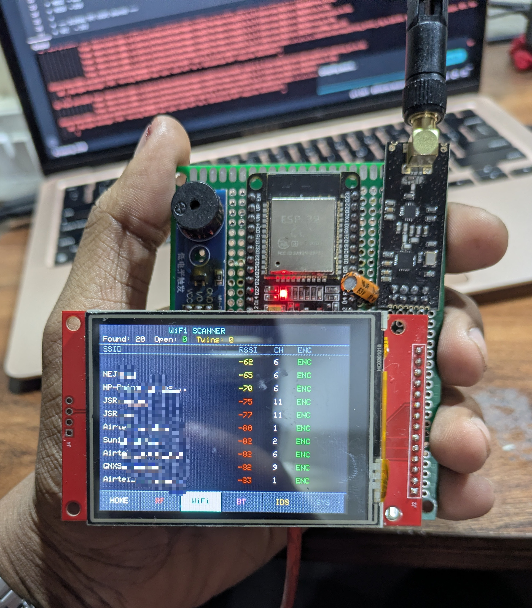
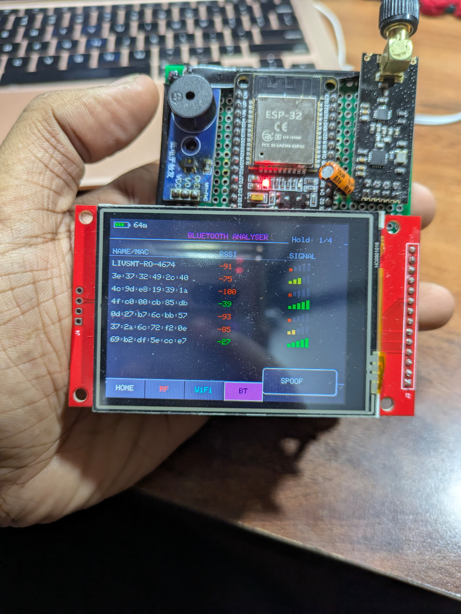
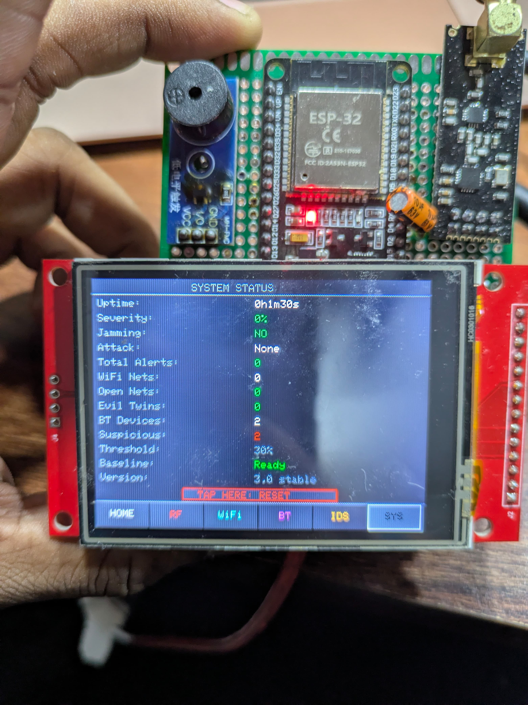

<div align="center">
<pre>
██╗    ██╗ █████╗ ████████╗ ██████╗██╗  ██╗██████╗  ██████╗  ██████╗
██║    ██║██╔══██╗╚══██╔══╝██╔════╝██║  ██║██╔══██╗██╔═══██╗██╔════╝
██║ █╗ ██║███████║   ██║   ██║     ███████║██║  ██║██║   ██║██║  ███╗
██║███╗██║██╔══██║   ██║   ██║     ██╔══██║██║  ██║██║   ██║██║   ██║
╚███╔███╔╝██║  ██║   ██║   ╚██████╗██║  ██║██████╔╝╚██████╔╝╚██████╔╝
 ╚══╝╚══╝ ╚═╝  ╚═╝   ╚═╝    ╚═════╝╚═╝  ╚═╝╚═════╝  ╚═════╝  ╚═════╝
</pre>

# WatchDog 2.4

**Portable 2.4 GHz Wireless Security Analyser**

[](.)
[](.)
[](.)
[](.)

*Real-time RF jammer detection · WiFi scanning · BLE tracker identification · Wireless IDS*

---



</div>

## What is WatchDog 2.4?

WatchDog 2.4 is a **handheld, battery-powered, offline wireless security analyser** built on the ESP32 microcontroller. It passively monitors the entire 2.4 GHz radio band — the frequency range shared by Wi-Fi, Bluetooth, BLE, RC drones, and many wireless protocols — and detects jamming attacks, rogue devices, and anomalous RF behaviour in real time.

No cloud. No server. No Wi-Fi needed during operation. Everything runs on the device.

---

## Features

### RF Spectrum Analysis
- Sweeps all **125 nRF24 channels** (2.400–2.524 GHz) continuously
- Live **125-channel spectrum waterfall** with peak-hold display
- Adaptive per-channel **noise floor calibration** (64-sample IIR)
- Asymmetric exponential smoothing filter (fast attack, slow decay)

### Jammer Detection — 9 Threat Types

| Threat Type | Label | Detection Method |
|---|---|---|
| Broadband burst | `Broadband_Jammer` | Instant path — early-exit spike detection (~80ms) |
| WiFi deauth flood | `WiFi_Deauth_Flood` | Contiguous block ≥10 ch, persistence ≥3 |
| Drone FHSS link | `Drone_FHSS_Link` | Hop counter ≥5, distance sum ≥80 ch in 2s |
| Sweep jammer | `RF_Sweep_Jammer` | Directional peak movement >6 consecutive steps |
| High entropy noise | `High_Entropy_Noise` | Shannon entropy H>3.8 or anomaly score >200 |
| RC/drone band | `RC_Drones_1-125_CH` | Active ch 84–124, activePct >30% |
| WiFi band | `WiFi_14_CH` | Dense contiguous block with peak energy |
| BLE band | `BLE_40_CH` | Even-channel dominant pattern |
| Bluetooth band | `Bluetooth_80_CH` | Broadband non-RC energy, btCount ≥15 |

### WiFi Scanner
- Async non-blocking scan — **never freezes the main loop**
- Detects **open access points** and **Evil Twin** duplicate SSIDs
- **Camera OUI detection** — Hikvision, Dahua, Reolink, Wyze, TP-Link Tapo, Ezviz

### Bluetooth / BLE Mapper
- **Active BLE scan** — captures full device names via scan response packets
- Detects **AirTag, Tile, SmartTag, FindMy, Chipolo** by OUI + name keyword
- **Hidden device heuristic** — flags nameless devices with RSSI > -65 dBm

### Special Modes
- **RF Foxhunt** — Geiger counter audio feedback for signal hunting
- **Lens Scanner** — detects hidden camera reflections from RF stability patterns
- **Wireless IDS** — 5 persistence counter gauges + live alert log
- **ECO Mode** — dims backlight, suspends BLE, extends battery life
- **Deep sleep with touch wakeup** — tap screen to resume, no power cycle needed

---

## Device Photos

| WiFi Scanner | Bluetooth Mapper | System Status |
|:---:|:---:|:---:|
|  |  |  |
| 20 networks captured | 7 BLE devices, -27 dBm | 1m30s uptime, clean |

---

## Hardware

### Bill of Materials

| Component | Qty | Approx. Price (India) |
|---|---|---|
| ESP32 DevKit v1 (30-pin) | 1 | ₹280–350 |
| nRF24L01+ PA/LNA module | 1 | ₹150–220 |
| ILI9341 2.4" TFT w/ XPT2046 | 1 | ₹350–450 |
| Passive buzzer (3-pin, 3.3V) | 1 | ₹20–40 |
| 100µF electrolytic capacitor | 2 | ₹10 |
| TP4056 LiPo charge module | 1 | ₹40–70 |
| 3.7V LiPo battery (1000–2000mAh) | 1 | ₹200–350 |
| Slide switch, perfboard, headers, wires | — | ₹150–200 |
| **Total** | | **~₹1,200–1,700** |

> Sources: Robu.in · Evelta.com · Robokits.co.in · Amazon.in · SP Road, Bengaluru

### Pin Assignment
```
ESP32               nRF24L01+
GPIO18 SCK    →     SCK
GPIO23 MOSI   →     MOSI
GPIO19 MISO   →     MISO
GPIO22 CE     →     CE
GPIO21 CSN    →     CSN
3.3V          →     VCC  + 100µF cap to GND (MANDATORY)

ESP32               ILI9341 TFT
GPIO18 SCK    →     SCK  (shared SPI)
GPIO23 MOSI   →     MOSI (shared SPI)
GPIO5         →     CS
GPIO32        →     DC
GPIO33        →     RST
GPIO27        →     BL   (PWM backlight)
GPIO13        →     T_CS (XPT2046 touch)
GPIO4         →     T_IRQ  ← deep sleep wakeup source (v3.1)

ESP32               Buzzer
GPIO26        →     Signal
```

> ⚠️ nRF24L01 must be powered from ESP32 3.3V rail — never directly from TP4056 OUT+

---

## Software Architecture
```
┌─────────────────────────────────────────────────┐
│              loop()  —  Core 1                  │
│  handleTouch() → processPendingActions()        │
│  buzzerUpdate() → handlePowerAndBacklight()     │
│  runGeigerCounter() → runRFChunk() [10ms]       │
│  scanWifiAsync() → triggerAsyncBLE() [gated]    │
│  runHealthMonitor() → redrawPage() [120ms]      │
└────────────────────┬────────────────────────────┘
                     │  FreeRTOS mutex (bleMutex)
┌────────────────────▼────────────────────────────┐
│       BLECb::onResult()  —  Core 0              │
│  Writes: bDevs[], bCount2, bSus, bTrackers      │
└─────────────────────────────────────────────────┘
```

**Key design decisions:**
- Single cooperative loop — no custom RTOS tasks
- All network scans async — WiFi and BLE never block `loop()`
- Deferred-action queue — touch handler enqueues, main loop executes
- FreeRTOS mutex — eliminates Core 0 / Core 1 data race on BLE shared data
- Zero Arduino `String` objects — entire codebase uses `char[]` arrays

---

## Installation
```
Board:   ESP32 Dev Module (Espressif v2.x or v3.x)
CPU:     240 MHz
Flash:   4MB — Default Partition Scheme
```

**Libraries (Arduino Library Manager):**
- `RF24` by TMRh20
- `Adafruit GFX Library`
- `Adafruit ILI9341`
- `XPT2046_Touchscreen` by Paul Stoffregen

**Upload** `Watchdog_Final_V1.ino` → expected Serial output:
```
[OK] WatchDog v3.1 HARDENED running
Active: 2/125 (2%) -- clean
```

---

## Documentation

| Document | Description |
|---|---|
| [Wiring Schematic](docs/WatchDog_2.4_Wiring_Schematic.html) | Full GPIO map, colour-coded wire routes |
| [Bill of Materials](docs/WatchDog_2.4_BOM.pdf) | India sourcing guide with prices |
| [Code Documentation](docs/Watchdog_Code_Documentation.pdf) | Architecture, algorithms, upgrade guide |
| [Technical Report](docs/Watchdog.pdf) | Full technical documentation |

---

## v3.1 Changelog

| Severity | Fix |
|---|---|
| 🔴 CRITICAL | FreeRTOS mutex — eliminated Core 0/Core 1 BLE data race |
| 🔴 CRITICAL | Deep sleep touch wakeup — no more power cycle required |
| 🟠 HIGH | `earlyActive` reset per pass — prevents false positive accumulation |
| 🟠 HIGH | `scaleMultiplier` capped at 4× — prevents early trigger saturation |
| 🟠 HIGH | All `String` heap allocations replaced with `char[]` |
| 🟠 HIGH | RF PA level set to MIN — eliminates SPI self-interference |
| 🟡 MEDIUM | Active BLE scan — captures full device names |
| 🟡 MEDIUM | `reflectionSpike` and `totalAlerts` overflow protection |
| 🟢 LOW | Camera OUI: 4 → 7 entries · Tracker DB expanded |

---

## Roadmap

- **v3.2** — Edge Impulse neural network classifier
- **v3.3** — SD card spectrum logging
- **v3.4** — MQTT remote alert push
- **v7.0** — Custom PCB, hardware fuel gauge, 3D-printed enclosure

---

## Legal

> Passive device only. WatchDog 2.4 does not transmit any radio signal. Designed for legitimate security research and education.

*© 2026 Anirudh N.S. — Personal cybersecurity portfolio project. Built for learning and demonstration purposes.*

---

<div align="center">

*Built on ESP32 + nRF24L01 + ILI9341 · Bengaluru, India · 2026*

*AI-assisted development: Claude Sonnet 4.6 (Anthropic) · Gemini 3.1 Pro (Google)*

</div>
